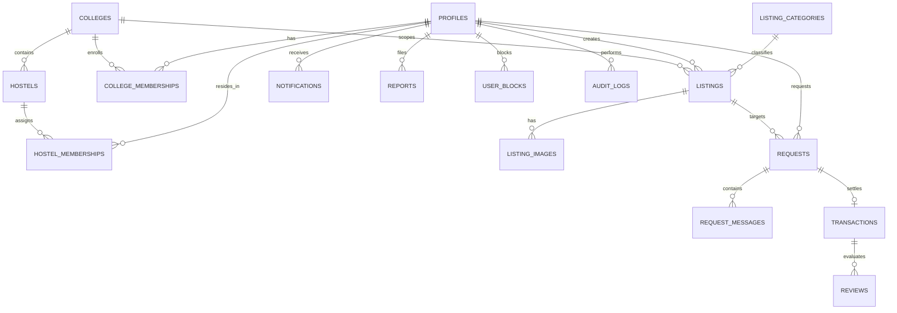

# HostelHub: Database Schema & Entity Relationships

## 1. Schema Overview & Relational Architecture

The database is built on PostgreSQL inside Supabase, utilizing strict relational integrity, foreign key cascades, and check constraints to guarantee multi-college data boundaries and prevent corrupt data states.

---

## 2. Table Definitions & Constraints

### 2.1 `colleges`
Institution registration and validation parameters.
- `id` (UUID, Primary Key, default `gen_random_uuid()`)
- `name` (TEXT, NOT NULL)
- `domain` (TEXT, NULL, e.g., `@campus.edu` for automatic verification)
- `slug` (TEXT, UNIQUE, NOT NULL)
- `is_active` (BOOLEAN, default `TRUE`)
- `created_at` (TIMESTAMPTZ, default `NOW()`)

### 2.2 `hostels`
Hostel buildings and resident blocks within a college.
- `id` (UUID, Primary Key)
- `college_id` (UUID, NOT NULL, REFERENCES `colleges(id)` ON DELETE RESTRICT)
- `name` (TEXT, NOT NULL, e.g., "Aryabhata Hall of Residence")
- `block_name` (TEXT, NOT NULL, e.g., "Wing B")
- `gender_policy` (TEXT, CHECK `gender_policy IN ('COED', 'MALE_ONLY', 'FEMALE_ONLY')`)
- `created_at` (TIMESTAMPTZ, default `NOW()`)

### 2.3 `profiles`
User metadata extending `auth.users`.
- `id` (UUID, Primary Key, REFERENCES `auth.users(id)` ON DELETE CASCADE)
- `full_name` (TEXT, NOT NULL)
- `avatar_url` (TEXT, NULL)
- `bio` (TEXT, NULL)
- `created_at` (TIMESTAMPTZ, default `NOW()`)
- `updated_at` (TIMESTAMPTZ, default `NOW()`)

### 2.4 `college_memberships`
Verifies a student's affiliation with an institution.
- `id` (UUID, Primary Key)
- `user_id` (UUID, NOT NULL, REFERENCES `profiles(id)` ON DELETE CASCADE)
- `college_id` (UUID, NOT NULL, REFERENCES `colleges(id)` ON DELETE CASCADE)
- `role` (TEXT, NOT NULL, CHECK `role IN ('STUDENT', 'MODERATOR', 'ADMIN')`, default `'STUDENT'`)
- `verification_status` (TEXT, NOT NULL, CHECK `verification_status IN ('PENDING', 'VERIFIED', 'REJECTED')`, default `'PENDING'`)
- `verified_at` (TIMESTAMPTZ, NULL)
- `created_at` (TIMESTAMPTZ, default `NOW()`)
- *Unique Constraint*: `UNIQUE(user_id, college_id)`

### 2.5 `hostel_memberships`
Tracks residency inside a specific hostel building.
- `id` (UUID, Primary Key)
- `user_id` (UUID, NOT NULL, REFERENCES `profiles(id)` ON DELETE CASCADE)
- `hostel_id` (UUID, NOT NULL, REFERENCES `hostels(id)` ON DELETE RESTRICT)
- `room_number` (TEXT, NOT NULL) - *STRICTLY CONFIDENTIAL; hidden from global search*
- `is_current` (BOOLEAN, default `TRUE`)
- `created_at` (TIMESTAMPTZ, default `NOW()`)

### 2.6 `listing_categories`
Configurable categorization for campus essentials.
- `id` (UUID, Primary Key)
- `name` (TEXT, NOT NULL)
- `slug` (TEXT, UNIQUE, NOT NULL)
- `description` (TEXT, NULL)
- `icon_name` (TEXT, NOT NULL)
- `is_active` (BOOLEAN, default `TRUE`)

### 2.7 `listings`
Item inventory posted by students.
- `id` (UUID, Primary Key)
- `college_id` (UUID, NOT NULL, REFERENCES `colleges(id)` ON DELETE CASCADE)
- `hostel_id` (UUID, NOT NULL, REFERENCES `hostels(id)` ON DELETE RESTRICT)
- `seller_id` (UUID, NOT NULL, REFERENCES `profiles(id)` ON DELETE CASCADE)
- `category_id` (UUID, NOT NULL, REFERENCES `listing_categories(id)` ON DELETE RESTRICT)
- `title` (TEXT, NOT NULL)
- `description` (TEXT, NULL)
- `quantity` (INTEGER, NOT NULL, CHECK `quantity >= 1`)
- `condition` (TEXT, NOT NULL, CHECK `condition IN ('NEW_SEALED', 'LIKE_NEW', 'GENTLY_USED')`)
- `price` (NUMERIC(10, 2), NOT NULL, CHECK `price >= 0`, default `0.00`)
- `exchange_preference` (TEXT, NOT NULL, CHECK `exchange_preference IN ('FIXED_PRICE', 'BARTER', 'NEGOTIABLE', 'FREE')`)
- `is_available_tonight` (BOOLEAN, default `FALSE`)
- `status` (TEXT, NOT NULL, CHECK `status IN ('ACTIVE', 'RESERVED', 'COMPLETED', 'EXPIRED', 'SUSPENDED')`, default `'ACTIVE'`)
- `food_best_before` (DATE, NULL) - *Mandatory if category is food*
- `expires_at` (TIMESTAMPTZ, NOT NULL, default `NOW() + INTERVAL '3 days'`)
- `created_at` (TIMESTAMPTZ, default `NOW()`)
- `updated_at` (TIMESTAMPTZ, default `NOW()`)

### 2.8 `listing_images`
Image attachments for listings.
- `id` (UUID, Primary Key)
- `listing_id` (UUID, NOT NULL, REFERENCES `listings(id)` ON DELETE CASCADE)
- `image_url` (TEXT, NOT NULL)
- `created_at` (TIMESTAMPTZ, default `NOW()`)

### 2.9 `requests`
Negotiation and purchase lifecycle between buyer and seller.
- `id` (UUID, Primary Key)
- `listing_id` (UUID, NOT NULL, REFERENCES `listings(id)` ON DELETE CASCADE)
- `buyer_id` (UUID, NOT NULL, REFERENCES `profiles(id)` ON DELETE CASCADE)
- `seller_id` (UUID, NOT NULL, REFERENCES `profiles(id)` ON DELETE CASCADE)
- `status` (TEXT, NOT NULL, CHECK `status IN ('PENDING', 'ACCEPTED', 'NEGOTIATING', 'REJECTED', 'CANCELLED', 'READY_FOR_HANDOVER', 'COMPLETED', 'DISPUTED')`, default `'PENDING'`)
- `proposed_terms` (TEXT, NOT NULL, CHECK `proposed_terms IN ('CASH', 'BARTER', 'CUSTOM')`)
- `proposed_price` (NUMERIC(10, 2), NULL, CHECK `proposed_price >= 0`)
- `proposed_barter_item` (TEXT, NULL)
- `message` (TEXT, NULL)
- `handover_note` (TEXT, NULL)
- `created_at` (TIMESTAMPTZ, default `NOW()`)
- `updated_at` (TIMESTAMPTZ, default `NOW()`)

### 2.10 `transactions`
Settled and verified transactions.
- `id` (UUID, Primary Key)
- `request_id` (UUID, UNIQUE, NOT NULL, REFERENCES `requests(id)` ON DELETE RESTRICT)
- `listing_id` (UUID, NOT NULL, REFERENCES `listings(id)` ON DELETE RESTRICT)
- `buyer_id` (UUID, NOT NULL, REFERENCES `profiles(id)` ON DELETE RESTRICT)
- `seller_id` (UUID, NOT NULL, REFERENCES `profiles(id)` ON DELETE RESTRICT)
- `final_price` (NUMERIC(10, 2), NOT NULL, default `0.00`)
- `final_barter_item` (TEXT, NULL)
- `buyer_confirmed` (BOOLEAN, default `FALSE`)
- `seller_confirmed` (BOOLEAN, default `FALSE`)
- `completed_at` (TIMESTAMPTZ, NULL)
- `created_at` (TIMESTAMPTZ, default `NOW()`)

### 2.11 `reviews`
Peer reviews on completed trades.
- `id` (UUID, Primary Key)
- `transaction_id` (UUID, NOT NULL, REFERENCES `transactions(id)` ON DELETE CASCADE)
- `reviewer_id` (UUID, NOT NULL, REFERENCES `profiles(id)` ON DELETE CASCADE)
- `reviewee_id` (UUID, NOT NULL, REFERENCES `profiles(id)` ON DELETE CASCADE)
- `rating` (INTEGER, NOT NULL, CHECK `rating BETWEEN 1 AND 5`)
- `comment` (TEXT, NULL)
- `created_at` (TIMESTAMPTZ, default `NOW()`)
- *Unique Constraint*: `UNIQUE(transaction_id, reviewer_id)`

### 2.12 `reports` & `moderation_actions`
Trust and safety mechanisms.
- `reports`: Tracks flagged items or offending students with categories and review states.
- `user_blocks`: Allows students to mutually prevent interaction.
- `audit_logs`: Immutable security trail tracking privileged administrative changes.

---

## 3. Row Level Security (RLS) Strategy

All tables enforce RLS enabled by default:
1. `listings`: Readable only by authenticated users belonging to the same `college_id`. Writable only by `seller_id`.
2. `requests`: Readable and writable only by the `buyer_id`, `seller_id`, or authorized college `MODERATOR`.
3. `hostel_memberships`: `room_number` is never selected by public queries; only visible to the user themselves.
