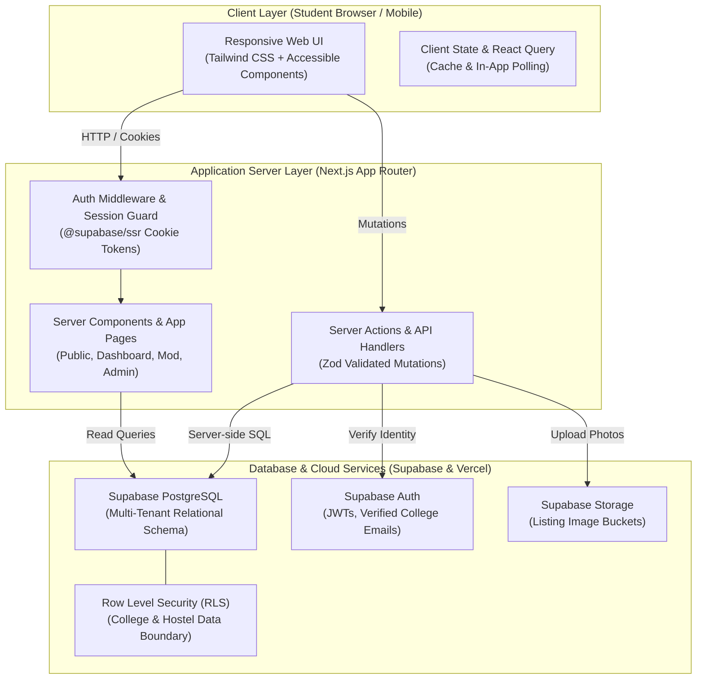
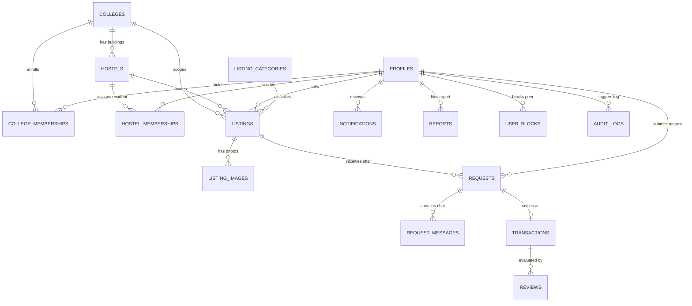

# HostelHub: Phase 0 Specification & Foundations

## 1. Workspace & Tooling Audit

- **Workspace Path**: `C:\Users\Suruchi\Downloads\Hostel App`
- **Legacy Files**: `app.py`, `templates/signup.html`, `templates/add_item.html`, `instance/hostel.db` (A simple Flask/SQLite script; retained for reference, ignored by Git).
- **Git**: Installed (`v2.56.0`). Initialized empty repo with `.gitignore`.
- **Node.js / npm**: Not currently in system PATH. Must be installed via `winget install OpenJS.NodeJS.LTS` or from [nodejs.org](https://nodejs.org).
- **Target Stack**: Next.js 15+ (App Router), TypeScript, Tailwind CSS, Supabase (PostgreSQL, Auth, RLS, Storage), Vercel.

---

## 2. Concise Product Requirements Document (PRD)

### 2.1 The Problem
Late at night, campus canteens and stationery shops close. Students face urgent shortages of essentials (packaged snacks, menstrual hygiene, toiletries, chargers) when leaving hostel gates is restricted by curfew. Other hostel residents in the same building often have these items in their rooms.

### 2.2 Core Value Proposition
HostelHub enables verified students within the same college to discover, request, and safely exchange permitted items with fellow residents in their immediate hostel community.

### 2.3 Permitted vs. Prohibited Items
- **Permitted**: Commercially sealed, packaged snacks with visible expiry dates (noodles, biscuits); sealed menstrual hygiene & personal care (pads, toothpaste, soap); academic supplies (notebooks, pens, calculators); everyday electronics/accessories (chargers, adapters).
- **Strictly Prohibited**: Prepared/cooked homemade food, unsealed food, expired food, prescription medication, alcohol, tobacco/vaping products, illegal substances, dangerous appliances.

### 2.4 Feature Scope: MVP vs. Postponed

| Feature Area | Included in Phase 1-9 MVP | Postponed to Future Iterations |
| :--- | :--- | :--- |
| **Authentication** | Email auth + campus domain matching + admin approval fallback | SMS OTP verification, biometric SSO, DigiLocker / ID card OCR |
| **Community Isolation** | Multi-college and hostel block scoping enforced in PostgreSQL RLS | Automatic GPS geofencing around campus boundaries |
| **Listings** | Fast creation, photos, quantity, category, "Available tonight", expiry | Barcode scanning, automatic receipt scanning, wholesale bulk orders |
| **Search** | Keyword search, college/hostel filter, category-based alternatives | AI vector/semantic embeddings, visual image search |
| **Transactions** | Requests, cash or barter proposals, counter-offers, atomic reservation lock | In-app credit card processing, payment gateway escrow, Stripe/UPI integration |
| **Handover** | Agreed common-area pickup coordination; room numbers kept hidden | Turn-by-turn indoor room navigation, live GPS delivery tracking |
| **Notifications** | In-app polling & badge counts for active trades | External WhatsApp alerts, native mobile push notifications |
| **Trust & Safety** | Listing & user reports, user blocking, verified trade star ratings | Automated identity background checks, automated toxic image computer vision |
| **Monetization** | 100% Free MVP; architecture prepared for optional transaction fee | In-app paid ads, vendor partnerships, subscription fees |

---

## 3. System Architecture (Mermaid)



---

## 4. Database Relationship Diagram (Mermaid)



---

## 5. Proposed Folder Structure

```
c:/Users/Suruchi/Downloads/Hostel App/
├── docs/                        # Project architectural and operational documentation
│   ├── ARCHITECTURE.md          # System design & tech choices
│   ├── DATABASE_SCHEMA.md       # Relational tables & RLS policies
│   ├── DECISIONS.md             # Architecture Decision Records (ADRs)
│   ├── DEPLOYMENT.md            # Setup and deployment guides
│   ├── PHASE_0_SPECIFICATION.md # Full Phase 0 specification
│   ├── PRODUCT_SPEC.md          # Product specs & user stories
│   ├── SECURITY.md              # Threat model & safety guidelines
│   └── TEST_PLAN.md             # Comprehensive test suites
├── public/                      # Static assets, icons, logo
├── src/
│   ├── app/                     # Next.js App Router
│   │   ├── (auth)/              # /login, /signup, /verify, /callback
│   │   ├── (dashboard)/         # /dashboard, /search, /listings, /requests, /history, /profile
│   │   ├── (public)/            # /, /how-it-works, /rules, /privacy, /terms
│   │   ├── admin/               # /admin, /admin/colleges, /admin/hostels
│   │   ├── mod/                 # /mod, /mod/reports, /mod/queue
│   │   ├── api/                 # Webhooks and health check endpoints
│   │   ├── layout.tsx           # Root layout
│   │   └── globals.css          # Tailwind CSS directives
│   ├── components/              # Modular UI components
│   │   ├── layout/              # Navbar, MobileNav, Footer, Sidebar
│   │   ├── listings/            # ListingCard, ListingGrid, CreateListingForm, PhotoUploader
│   │   ├── requests/            # RequestCard, NegotiationTimeline, HandoverConfirmation
│   │   ├── search/              # SearchBar, FilterSheet, AlternativeSuggestionCard
│   │   └── ui/                  # Button, Card, Badge, Input, Dialog, Dropdown, Skeleton
│   ├── lib/                     # Utilities & clients
│   │   ├── auth/                # Session helpers & role checkers
│   │   ├── supabase/            # server.ts, client.ts, middleware.ts
│   │   └── utils/               # formatters, dates, cn() helper
│   ├── schemas/                 # Zod validation schemas
│   │   ├── listing.ts           # Schema for item creation & editing
│   │   ├── request.ts           # Schema for negotiation & trade offers
│   │   └── report.ts            # Schema for reporting bad actors
│   └── types/                   # TypeScript interfaces
│       ├── database.ts          # Supabase generated database types
│       └── index.ts             # App-specific UI types
├── supabase/
│   ├── migrations/              # 001_initial_schema.sql, 002_rls_policies.sql
│   └── seed.sql                 # Sample colleges, hostels & categories for local dev
├── tests/                       # Unit, integration and isolation tests
├── .env.example                 # Environment variable template
├── .gitignore                   # Ignored files (secrets, node_modules)
├── AGENTS.md                    # Antigravity persistent guidelines
├── package.json                 # Node dependencies (initialized in Phase 1)
├── tsconfig.json                # Strict TypeScript configuration
└── README.md                    # Project overview
```

---

## 6. External Services & Accounts to Configure

| Service | Why it is needed | Account Action Needed from User |
| :--- | :--- | :--- |
| **Node.js LTS** | Runs the JavaScript/TypeScript build tools and development server. | Run `winget install OpenJS.NodeJS.LTS` or download installer from [nodejs.org](https://nodejs.org). |
| **Supabase** | Provides the PostgreSQL database, authentication, Row Level Security, and image storage. | Create a free project at [supabase.com](https://supabase.com). Copy URL, Anon Key, and Service Role Key into `.env.local`. |
| **Vercel** *(Optional until Phase 9)* | Hosts and serves the web application on the public web. | Sign in at [vercel.com](https://vercel.com) with GitHub when ready to deploy. |

---

## 7. Security Threat Model

| Threat | Attack Scenario | Architectural Defense |
| :--- | :--- | :--- |
| **Cross-College Access (IDOR)** | Student at College A changes listing ID or passes College B's ID to view/request items. | **PostgreSQL RLS**: Every query enforces `college_id = user_college_id()`. Server Actions ignore client `college_id` and fetch it from verified session. |
| **Student Privacy & Stalking** | Bad actor scrapes room numbers or phone numbers to track students to their rooms. | **Data Redaction**: Room numbers and personal contact details are completely omitted from public/search queries. Handover is restricted to agreed common areas. |
| **Listing Ownership Manipulation** | Attacker sends a mutation modifying or deleting another student's listing. | **Ownership Verification**: SQL RLS policy `seller_id = auth.uid()` on all `UPDATE` and `DELETE` operations. |
| **Transaction Manipulation & Race Conditions** | Two buyers simultaneously claim the last unit of an essential item, or modify agreed price. | **Atomic Conditional Updates**: `UPDATE listings SET status = 'RESERVED' WHERE id = ... AND status = 'ACTIVE' RETURNING id`. Dual confirmation required to complete. |

---

## 8. Phased Implementation Roadmap & Acceptance Criteria

- **Phase 1: Project Setup, Design System & Routing Shell**
  - *Criteria*: Next.js App Router runs on `localhost:3000`; Tailwind CSS active; shared accessible components (Button, Input, Card, Modal, Mobile Nav) render cleanly; sitemap routes accessible.
- **Phase 2: Database Migrations, Supabase Auth & RLS**
  - *Criteria*: Tables, constraints, and indexes provisioned; RLS enabled on every table; sign-up, sign-in, and session middleware functioning.
- **Phase 3: Student Onboarding & Core Listing Lifecycle**
  - *Criteria*: Student can select verified college & hostel; create listing with valid fields & photos; update and expire listing; negative prices/quantities rejected by Zod.
- **Phase 4: Search Engine & Smart Alternative Suggestions**
  - *Criteria*: Database search filters by keyword, hostel, and category; when exact item unavailable, related category alternatives are suggested and explicitly labeled.
- **Phase 5: Requests, Terms Negotiation & Handover**
  - *Criteria*: Buyer submits cash/barter offer; seller accepts or counters; atomic reservation prevents double-booking; dual-confirmation completes trade; in-app notifications update.
- **Phase 6: Trust, Safety, Moderation & Ratings**
  - *Criteria*: Students can report listings/users; moderators can review queue and suspend violators; verified rating updates seller trust score.
- **Phase 7: Analytics, Empty States & Accessibility**
  - *Criteria*: Admin dashboard shows aggregate pilot metrics without PII leakage; graceful empty states with "Post Request"; WCAG 2.1 AA keyboard navigation verified.
- **Phase 8: Security Audit & Automated Testing**
  - *Criteria*: Automated tests verify cross-college isolation, room number concealment, race condition rejection, and role authorization; all assertions pass.
- **Phase 9: Production Deployment & Verification**
  - *Criteria*: App deployed to Vercel connected to live Supabase; production checklist and documentation verified.

---

## 9. Key Decisions Requiring User Approval

1. **MVP Scope Boundary**: Agreeing to postpone in-app payment escrow (cash or barter is settled directly between students and recorded in app) and GPS live tracking for the MVP pilot.
2. **Room Number Privacy**: Keeping room numbers 100% hidden from search and listings, using building names and common-area handovers.
3. **Authentication Strategy**: Using email magic link / college domain matching with manual admin invite approval for pilot colleges.
4. **Notification Mechanism**: Using in-app polling & badge counts for the MVP rather than complex WebSockets.
5. **Legacy Flask Code**: Retaining the existing `app.py` script as a historical reference while building the clean Next.js architecture.
